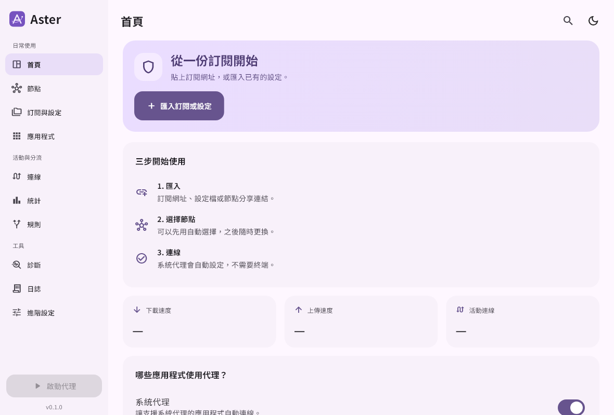
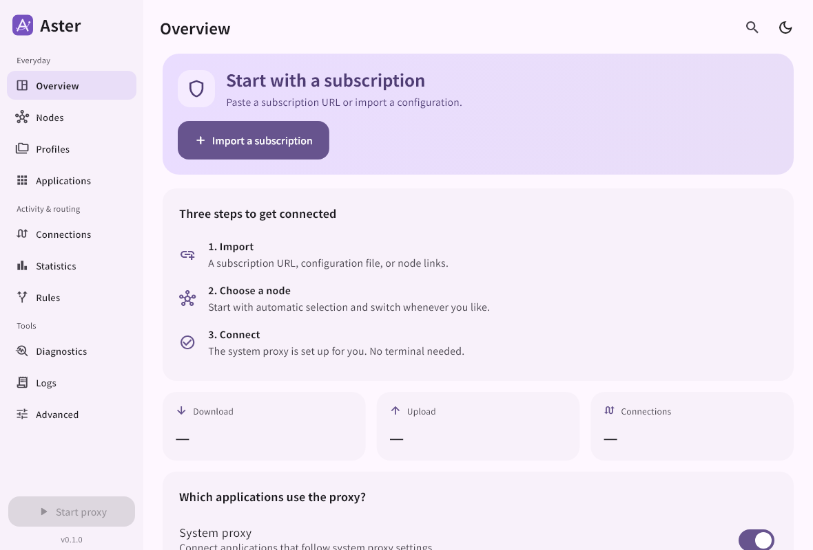
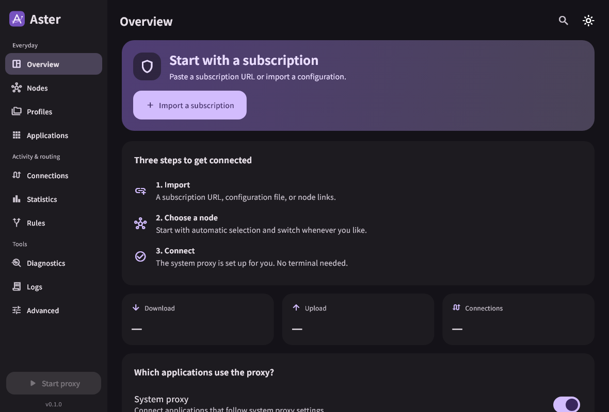

# Aster Desktop

**用桌面視窗管理代理，匯入訂閱 → 選擇節點 → 按下連線。**

Aster Desktop 是 Aster Core 的圖形客戶端，讓不習慣使用終端機的使用者也能管理代理。支援 Windows、macOS、Linux 與 Android，預設繁體中文；不用自行安裝核心或設定 Controller 位址與密碼。你需要準備自己的訂閱、節點連結或 Clash YAML。

**[下載 0.2.3 正式版](https://github.com/Miku0139oao/aster-desktop/releases/tag/v0.2.3)** · **[使用手冊](docs/USER_GUIDE.md)** · **[常見問題](docs/FAQ.md)** · [更新紀錄](CHANGELOG.md)

## 看看介面

首頁集中顯示連線狀態與常用操作；左側文字選單可進入節點、訂閱、應用程式分流、連線、統計、日誌與診斷。

以上是目前介面的初次使用畫面，以測試資料渲染，未包含私人訂閱。

查看淺色與深色介面

## 可以用它做什麼？

| 你想做的事 | 在哪裡操作 |
| --- | --- |
| 匯入訂閱、換一份設定、自動更新訂閱 | 訂閱與設定 |
| 挑節點、測延遲、收藏常用節點 | 節點 |
| 讓瀏覽器走某個節點、另一個程式直連 | 應用程式：從程式清單選擇，再指定出口 |
| 讓遊戲等不遵循系統代理的程式也使用代理 | 首頁：代理所有應用程式（TUN） |
| 查看哪個程式連去哪裡，並中止連線 | 連線 |
| 查看每日流量，或找出連不上網的原因 | 統計、診斷與日誌 |
| 調整 DNS、網域／IP 分流或完整 YAML | 規則、進階設定 |

**一般上網先用系統代理；按程式指定出口時，使用 TUN +「依規則」。** 系統代理／TUN 決定哪些流量進入核心，規則則決定流量使用哪個出口。[查看完整操作範例](docs/USER_GUIDE.md#應用程式與分流規則)。

## 下載與安裝

| 系統 | 建議下載 | 安裝方式 |
| --- | --- | --- |
| Android arm64／x86_64 | [Android APK](https://github.com/Miku0139oao/aster-desktop/releases/download/v0.3.1/Aster-Desktop-0.3.1-android.apk) | 開啟 APK；首次連線時允許 VPN 權限 |
| Windows 10／11 x64 | [Windows 安裝器](https://github.com/Miku0139oao/aster-desktop/releases/download/v0.2.3/Aster-Desktop-0.2.3-windows-x64-setup.exe) | 從托盤退出舊版後執行安裝器 |
| macOS 13+，Apple Silicon（M 系列） | [arm64 DMG](https://github.com/Miku0139oao/aster-desktop/releases/download/v0.2.3/Aster-Desktop-0.2.3-macos-arm64.dmg) | 開啟 DMG，執行其中的 PKG |
| macOS 13+，Intel | [amd64 DMG](https://github.com/Miku0139oao/aster-desktop/releases/download/v0.2.3/Aster-Desktop-0.2.3-macos-amd64.dmg) | 開啟 DMG，執行其中的 PKG |
| Ubuntu 24.04 x64，GNOME／KDE | [deb 套件](https://github.com/Miku0139oao/aster-desktop/releases/download/v0.2.3/Aster-Desktop-0.2.3-linux-x64.deb) | 使用系統套件安裝程式開啟 |
| Arch Linux x64，GNOME／KDE | [Arch 套件](https://github.com/Miku0139oao/aster-desktop/releases/download/v0.2.3/Aster-Desktop-0.2.3-linux-x64.pkg.tar.zst) | 使用套件管理員安裝 |

[所有檔案、Android APK、離線文件與來源碼](https://github.com/Miku0139oao/aster-desktop/releases/tag/v0.3.1) · [SHA-256 校驗碼](https://github.com/Miku0139oao/aster-desktop/releases/download/v0.3.1/SHA256SUMS)

Android 使用內建固定核心與固定 release signing key；更新可直接覆蓋安裝。桌面套件仍為 0.2.3，後續版本會分開標示。

Mac 套件使用本機簽署，尚未取得 Apple Developer ID 簽章／公證；首次開啟可能需要到「系統設定 → 隱私權與安全性」允許開啟。[安裝與授權說明](docs/USER_GUIDE.md#安裝與升級)列出詳細步驟與平台限制。

## 三步開始使用

1. 首頁按「匯入訂閱或設定」，選「訂閱網址」、「貼上內容」或「設定檔」，再按「匯入並檢查」。Aster Desktop 不提供訂閱或節點，需要使用你已有的有效設定。
2. 到「節點」選擇群組中的節點，也可以從首頁「目前節點 · 點擊更換」進入。遠端 provider 節點在核心啟動後載入。
3. 保持預設「系統代理」，按「開始連線」或側欄「啟動代理」。首頁會顯示目前節點、速度、累計流量與狀態。

完成後可關閉視窗留在托盤；要停止並完全退出，請在托盤選「退出」。重複開啟會喚回既有視窗。需要遊戲或其他不遵循系統代理的程式使用代理時，見[所有應用程式與 TUN](docs/USER_GUIDE.md#系統代理與-tun)。

## 日常功能

- **節點與訂閱**：群組卡片／列表、搜尋、收藏、排序、延遲測試、選擇自動／固定節點；多份設定、訂閱變更預覽、個別更新排程、節點與 provider 管理。支援 Clash YAML、明文／Base64 訂閱，以及 SS、VMess、VLESS、Trojan、HY2、TUIC、AnyTLS 分享連結（包含 AnyTLS + REALITY）。
- **應用程式與規則**：從圖形清單選已安裝／執行中的程式，指定群組、節點、直連或封鎖；可多選套用出口。支援網域／IP／程序分流、規則管理與完整 YAML 編輯／驗證／備份／還原。
- **連線與日誌**：搜尋、篩選、暫停、明細、中止連線、從連線建立規則；日誌支援多層級、來源、欄位搜尋及篩選匯出。
- **流量與診斷**：即時速度、核心本次累計、本機每日歷史與 CSV 匯出；依核心、背景服務、出口網路、DNS、系統路由及本機代理分開診斷。
- **桌面操作**：跨平台防止多開、托盤、Ctrl+K／⌘K 頁面搜尋、可選的登入自啟並連線。

系統代理／TUN 決定哪些流量進入核心，「依規則／全部代理／全部直連」決定進入核心後使用哪個出口。應用程式分流建議使用 **TUN + 依規則**。實作細節與操作範例見[使用手冊](docs/USER_GUIDE.md)。

## 更新與驗證狀態

0.2.3 正式版沿用已通過測試並由使用者確認可用的 0.2.3 beta 1 安裝包，二進位檔案與來源包的 SHA-256 相同；已安裝該測試版者不必重新安裝。GUI 由使用者下載安裝包升級；核心可在「進階設定 → 檢查更新」更新，下載時保持目前代理，驗證後才短暫重啟。

Windows、Ubuntu 24.04、Mac Intel／Apple Silicon 的 CI 與兩種 Mac 安裝驗證已通過；Mac 實機 TUN／網路／背景服務授權／Gatekeeper 互動／睡眠喚醒，以及 GNOME／KDE 桌面整合仍有待實機驗收項目。詳見[測試紀錄](docs/TESTING.md)，遇到問題請先查看[常見問題](docs/FAQ.md)。

## 文件與開發

- [完整使用手冊](docs/USER_GUIDE.md)：安裝、首次使用、分流、流量、更新、備份與退出。
- [常見問題與故障排除](docs/FAQ.md)：無法連線、TUN、授權、安裝、日誌與回報方式。
- [Android 版](docs/ANDROID.md)：VpnService、應用程式分流、權限、簽章與建置。
- [應用程式分流](docs/APPLICATION_ROUTING.md) · [日誌與連線查閱](docs/INSPECTION.md)。
- [開發與建置](docs/BUILDING.md) · [架構與介面](docs/ARCHITECTURE.md) · [測試紀錄](docs/TESTING.md) · [更新紀錄](CHANGELOG.md)。

## 授權與來源

GPL-3.0，見 [LICENSE](LICENSE) 與[第三方聲明](NOTICE.md)。0.2.3 執行程式來源固定於 [e3aab7a](https://github.com/Miku0139oao/aster-desktop/tree/e3aab7acba9e245a0858c01fd5be7fd976efd565)，內附核心與轉換器固定於 [a9a33503](https://github.com/Miku0139oao/aster-core/tree/a9a33503b39a03681bc52d9758907316a22df199)。發佈頁提供對應桌面與核心來源、建置腳本及校驗碼。
